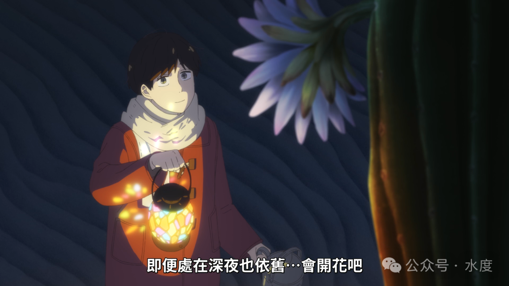
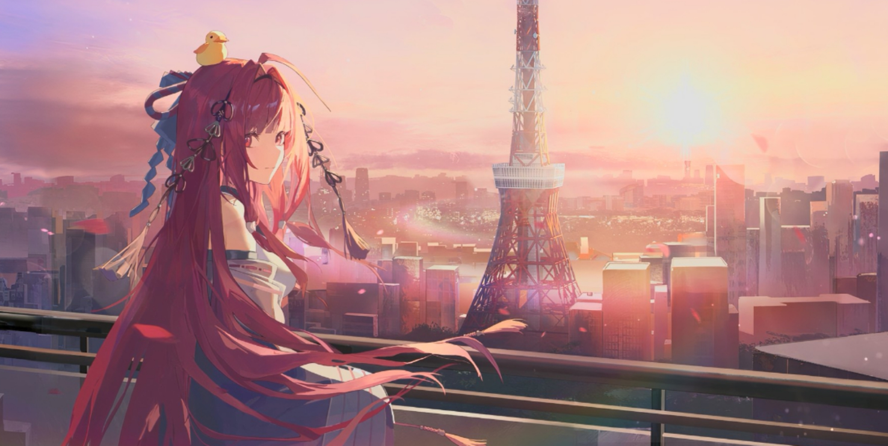
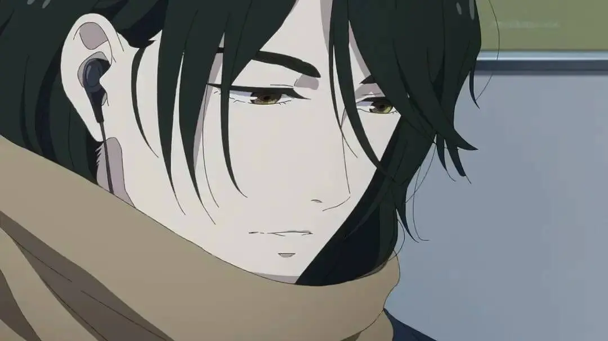
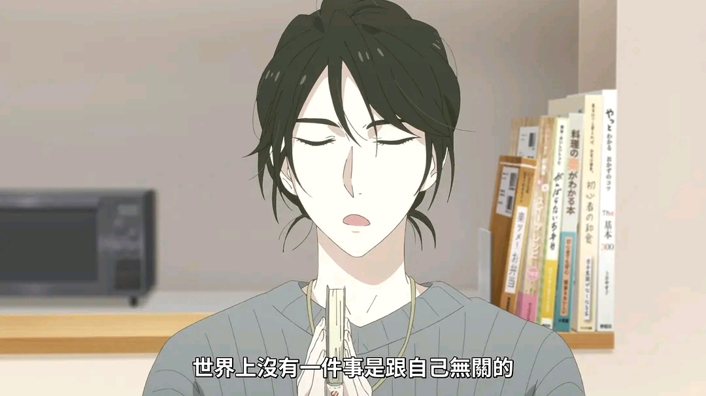

---
hide:
  - navigation
  - toc
title: 主页
---

<!-- ==================== Hero 区：左文字 + 入口，右照片 ==================== -->
<!-- 这里不加 markdown 属性：nl2br 会把块内换行变成  ，
     实测会凭空多出 90px 空白，把 hero 挤得很空。 -->

  

    
AQUACODR'S BLOG

    <h1 class="hero-title">学以聚之，思以辨之 偶得而栖之</h1>
    
一个我用来记录学习、生活与阅读感悟的地方，欢迎驻足。

    <nav class="hero-links">
      <a href="ZJU学习/">ZJU学习</a>
      <a href="自学/">自学</a>
      <a href="技术/">技术</a>
      <a href="阅读/">阅读</a>
      <a href="记忆碎片/">记忆碎片</a>
      <a href="野犬手记/">野犬手记</a>
    </nav>
  

  <a class="hero-feature" href="阅读/连续剧/东京爱情故事/">
    如果你在东京街头，遇到一个眼睛微笑得像月牙一样的女孩，那是我爱过的女孩，她的名字叫做赤名莉香。
  </a>

<!-- ==================== 光影收藏 ==================== -->
<h2 class="gallery-title">makio、asa、erii</h2>

  

    
  

  

    
  

  

    
  

  

    
  

